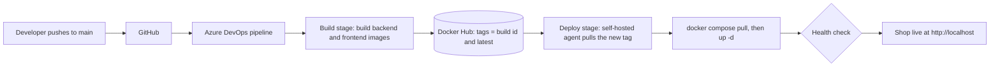
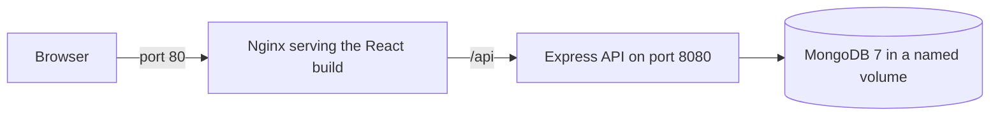

# E-Commerce CI/CD on Azure DevOps (MERN + Docker)

A complete CI/CD pipeline for a MERN e-commerce application. Every `git push` to `main` builds two Docker images, publishes them to Docker Hub, and deploys that exact version automatically, with a health check and rollback by image tag.

The application code was written by another developer (see [Credits](#credits)). My work is everything around it: containerization, configuration, the pipeline, deployment and operations.

## Architecture

**What happens on every push**



**How the running application is wired**



Only the frontend publishes a port. The backend and the database are reachable only inside the Docker network.

## Tech stack

| Layer | Technology |
| --- | --- |
| Frontend | React (Create React App), Redux Toolkit, Tailwind CSS |
| Reverse proxy | Nginx (serves the build, forwards `/api` to the backend) |
| Backend | Node.js 20, Express 4, Mongoose 7 |
| Database | MongoDB 7 (official image, named volume) |
| Containers | Docker, Docker Compose |
| CI/CD | Azure DevOps Pipelines (YAML) |
| Registry | Docker Hub |

## What I added to the application

| File | Purpose |
| --- | --- |
| `node-ecommerce/Dockerfile` | Backend image on `node:20-alpine`; dependencies are copied first so Docker can cache the install step |
| `react-ecommerce/Dockerfile` | Multi-stage build: Node builds the React app, then only the static files are copied into a small Nginx image |
| `react-ecommerce/nginx.conf` | Serves the app, forwards `/api/` to `backend:8080`, and falls back to `index.html` so page refreshes on React routes work |
| `docker-compose.yml` | Local development stack: `mongo`, `backend`, `frontend` |
| `docker-compose.prod.yml` | Production stack that pulls images from Docker Hub (`image:` with `${TAG}`) instead of building them, with restart policies |
| `node-ecommerce/seed.js` | Loads sample categories, brands and products through the API into a new, empty database |
| `azure-pipelines.yml` | The two-stage pipeline (Build, then Deploy) |
| `.dockerignore` files | Keep `node_modules`, `.git` and `.env` out of the images |

## Run it locally

Requires Docker Desktop.

```bash
git clone https://github.com/AmruthaUmashanker/Ecommerce.git
cd Ecommerce
docker compose up --build
```

- Shop: `http://localhost:3000`
- API: `http://localhost:8080`

A new database starts empty, so load the sample data once, in a second terminal:

```bash
docker compose exec backend node seed.js
```

Expected output: `categories: 6 ok`, `brands: 14 ok`, `products: 29 ok`. The seed does not create users; create a test account from the sign-up page.

## The pipeline

`azure-pipelines.yml` runs on every push to `main`.

| Stage | Runs on | What it does |
| --- | --- | --- |
| Build | Microsoft-hosted agent (`ubuntu-24.04`) | Builds the backend and frontend images and pushes them to Docker Hub as `amruthaumashanker/ecommerce-backend` and `amruthaumashanker/ecommerce-frontend`, tagged with `$(Build.BuildId)` and `latest` |
| Deploy | Self-hosted agent (`laptop-agent`) | Runs `docker compose pull` and `up -d` with `TAG=$(Build.BuildId)`, then polls `/api/products` until it returns a 2xx status |

Safeguards: the Deploy job fails if it runs longer than 15 minutes (`timeoutInMinutes: 15`), and it fails if the health check does not pass within about 160 seconds.

Typical run (`#20261014.1`): Build 2m 13s, Deploy 52s.

**To reproduce the pipeline you need:**

1. An Azure DevOps project connected to this GitHub repository.
2. A Docker Registry service connection named `dockerhub-connection` (Docker Hub username and an access token with Read and Write permission).
3. A self-hosted agent named `laptop-agent` in the `Default` pool: download the agent from Project settings, Agent pools, run `.\config.cmd`, then keep `.\run.cmd` running ("Listening for Jobs").
4. Docker Desktop running on the machine that hosts the agent.

Tokens are stored in the Azure DevOps service connection. No secret is committed to this repository.

## Deploy and roll back

The pipeline deploys automatically. To deploy or roll back a specific version by hand, set `TAG` to a build number from Docker Hub:

```powershell
# PowerShell
$env:TAG = "65"
docker compose -p ecommerce-prod -f docker-compose.prod.yml up -d
```

```bash
# bash
TAG=65 docker compose -p ecommerce-prod -f docker-compose.prod.yml up -d
```

Every build is an immutable, tagged image, so rolling back means redeploying an older tag. The first time on a new machine, seed the production database once:

```bash
docker compose -p ecommerce-prod -f docker-compose.prod.yml exec backend node seed.js
```

The shop is then served at `http://localhost`. The database lives in the named volume `ecommerce-prod_mongo-data`, so it survives redeploys.

## Changes I made to the application code

I kept these as small as possible. In a company they would be requests to the developers.

| Change | Why |
| --- | --- |
| `node-ecommerce/index.js`: read `MONGO_URI` and `PORT` from environment variables, with the old values as fallbacks | The database address was hardcoded to `127.0.0.1`, which inside a container means the container itself |
| `react-ecommerce/src`: replaced `http://localhost:8080` with `/api` in 19 places | In production the browser cannot reach `localhost:8080`; Nginx now forwards `/api` to the backend |
| `UserProfile.js`: `user?.name` instead of `user.name` | The profile page crashed when the user was not yet loaded |
| `react-ecommerce/public/index.html`: page title | Used to test the pipeline end to end |

## Problems I solved

| Problem | Cause | Fix |
| --- | --- | --- |
| `npm ci` failed in the frontend build | `package.json` and `package-lock.json` disagreed on the TypeScript version | Use `npm install` in the Dockerfile |
| Backend could not reach MongoDB in a container | Hardcoded `127.0.0.1` address | Environment variable, set to `mongodb://mongo:27017/eccomerce` in Compose |
| Frontend would break after deployment | API calls hardcoded to `localhost:8080` | Relative `/api` URLs and an Nginx reverse proxy |
| Shop showed no products | A new database is empty | `seed.js`, run once |
| Pipeline warning about `ubuntu-latest` changing to Ubuntu 26 | Moving image label | Pinned `vmImage: ubuntu-24.04` |
| Deploy job hung for over an hour | Docker Desktop's engine was paused and WSL hung at about 97% memory | Stopped unused containers, restarted WSL, capped its memory in `.wslconfig`, added a 15-minute job timeout |
| Health check never passed | It required HTTP 200, but the API returns 201 | Accept any status from 200 to 299 |
| Browser showed the old page title after a green deploy | Browser cache | Checked the server's response directly, then did a hard refresh |

## Known limitations

- MongoDB runs without authentication (it is reachable only inside the Docker network).
- The site is served over HTTP, not HTTPS.
- Deploys run on a laptop through a self-hosted agent, so they work only while the laptop and the agent are on.
- The sample product images are dead links in the original data.
- The seed script does not load users; use the sign-up page.
- The profile page needs a logged-in user in memory; persisting the login is a developer task.

## Roadmap

- Monitoring with Prometheus and Grafana
- HTTPS with Nginx on a domain
- Run the same Deploy stage on a cloud VM, with Azure Container Registry, Key Vault for secrets, and Terraform for the infrastructure
- Automated tests and image scanning in the Build stage
- Kubernetes manifests

## Credits

The application (React frontend, Express backend, MongoDB models and sample data) was written by Ketan Rathod: [ketan-rathod-713/Ecommerce](https://github.com/ketan-rathod-713/Ecommerce). This repository is a fork. The original project README is kept in `APP-README.md`. The containerization, configuration, pipeline and deployment work is mine ([@AmruthaUmashanker](https://github.com/AmruthaUmashanker)).